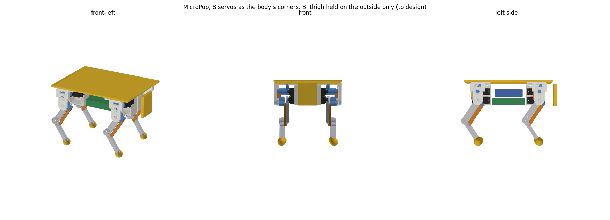

# MicroPup CAD

Printable parts written as code with [build123d](https://build123d.readthedocs.io), as in the DeskSprite case: sizes and clearances are parameters, and a checker tests the parts against stand-ins before anything is printed. The STLs in `stl/` are ready to slice. The assembled leg is in `step/leg-home.step`, which opens in FreeCAD, Fusion or any other CAD program.

```
cad/.venv/Scripts/python cad/leg.py           # parts -> stl/leg/, assembly -> step/leg-home.step
cad/.venv/Scripts/python cad/check_fit.py     # collisions over the range of motion (add --rear for a rear leg)
cad/.venv/Scripts/python cad/fit_coupon.py    # fit coupons -> stl/leg-fit/
cad/.venv/Scripts/python cad/render.py out.png [thigh knee abduction]
```

Set up the environment once with `python -m venv cad/.venv` and `cad/.venv/Scripts/python -m pip install build123d matplotlib`.

## The braced leg (chosen, 10 Nov 2026): `leg_braced.py`

After Pollen's MicroDuck leg: 12 MG92B, three per leg, with the hip and knee servos inside the thigh. This replaces the Orion-style leg below, which came out too wide.

```
cad/.venv/Scripts/python cad/leg_braced.py              # parts -> stl/braced/, assembly -> step/braced-home.step
cad/.venv/Scripts/python cad/check_fit.py all --braced  # add --rear for a rear leg
cad/.venv/Scripts/python cad/foot_first.py              # how far the leg can lean before anything but the foot touches
cad/.venv/Scripts/python cad/anim_export.py --braced    # then animate.py OUT.mp4 --braced in WSL
                                                        # (--replay walk.npz: a trained walk from the simulation)
```

**How it's built:**

- **Thigh shell and rigidity plate (`shell`, `rigidity-plate`).**
  - The hip servo sits at the top of the thigh and the knee servo at the bottom, both along the thigh, held by their tabs on the shell's end and middle blocks with the servo bag's M2 screws. The middle block leaves 1.6 mm between the two servos' tabs.
  - The rigidity plate covers the servos' case tops, around their bosses. Six M2 × 8 screws hold it into bosses on the shell's sides. So each servo case is clamped from both sides and becomes part of the structure, as in MicroDuck.
  - The shell's back carries the hip and knee pins: an M3 nut trapped from the servo side, and a standoff for a bearing's inner race.
- **Hip bracket (`bracket`, `outer-arm`).** A U around the top of the thigh.
  - The outer arm is screwed to the hip horn. It is a separate part (two M2.5 × 10 into the beam), so the thigh can go in.
  - The inner arm carries a 693 on the hip pin. The hip servo's body turns with the thigh, and the joint is held on both sides.
  - The beam over the thigh sits above the circle the shell's top sweeps (11.6 mm). The abduction plates hang from it: the horn in front, a 693 behind on the pin from the body-side cap (`abd-mount`), as in the Orion leg.
- **Shank (`shank-outer`, `shank-inner`, `shank-body`, `foot`): a "heel" fork that tapers to the foot.**
  - The outer plate sits on the knee horn, with the horn's arm pointing back along the plate. The inner plate turns on a 693 on the knee pin.
  - Both plates reach back and up from the knee to a 7 mm rod 19 mm behind it. Each plate is held to the rod's end by one M2.5 × 8.
  - From the rod, a 6 mm bar runs around the back of the knee and down to the foot stub. Below the knee, the leg is only that bar.
  - The folding thigh only sweeps the shank's front: from straight up at a straight knee to 30° short of straight down at 150°. So the rod and the bar stay clear of it.

**Foot first.** How far the leg can lean sideways (abduction plus body roll) before any other part touches a flat floor ahead of the foot. The figures come from `foot_first.py`.

| Pose | First fork, crossbar 26–31 mm below the knee | Heel fork |
| --- | --- | --- |
| Straight leg | 41° (fork plates) | 63° (hip bracket) |
| Standing (home) | 36° (fork plates) | 58° (hip bracket) |
| Crouched (hip 48 mm up) | 27° (fork plates), less than the abduction range | 43° (fork plates at the knee) |

When the knee is folded to 150°, the heel rod is the lowest point of the leg. That is what a folded leg rests on.

**Range of motion:** no collisions over any of the 27 test poses, front and rear legs.

| Joint | Range |
| --- | --- |
| Knee | 0–150° (the sim's full range); the knee servo is the knee joint, with no linkage |
| Hip | 70° back to 80° forward of home |
| Abduction | ±29° in every combination |

The abduction axis is 24 mm inside the servos' case bottoms, 4 mm further in than the Orion leg. That way, outward abduction swings the bracket's inner arm over the abduction servo, not into it.

**Width:** the leg spans from 10.7 mm inside the servos' case bottoms to 35.8 mm outside them, 46.5 mm in all, against 69 mm for the Orion leg. With a 44 mm body the shoulders are about 141 mm across and the feet about 95 mm apart (Orion leg: 184 and 153).

**Mass:** the moving printed parts come to 33 g per leg (Orion leg: 38 g). Add three 693s and about 5 g of screws. The knee servo's 13.8 g sits at the knee, so the leg is heavier to swing than the Orion leg's but lighter overall.

**Placeholders:** the same servo and horn sizes as below, checked by the same fit coupons. The middle block's 1.6 mm between the servos' tabs depends on the tab span; if the real tabs are longer, trim them.

## Layout study: 8 servos as the body's corners (11 Nov 2026): `layout_corner8.py`

After Mini Pupper 4, whose motor drums are the corners of its body with only flat leg parts outside them. Each corner here is the Orion-style leg's holder fixed to the body, with no abduction joint: the hip and knee servos one above the other, and the knee driven through the Orion links. It is a study to measure widths and clearances, not a set of printable parts. The deck, the parts inside and the face are stand-in boxes.

```
cad/.venv/Scripts/python cad/layout_corner8.py   # widths, fit check, pictures -> step/corner8-a.png, corner8-b.png
                                                 # (--step: the assemblies too, about 4 MB each)
```

| Layout | Servos | Across the shoulders | Feet apart |
| --- | --- | --- | --- |
| Braced legs (chosen) | 12 | 141 mm | 95 mm |
| Orion legs | 12 | 184 mm | 153 mm |
| A: corner holders, Orion leg parts as they are | 8 | 129.6 mm | 103.6 mm |
| B: corner holders, thigh held on the outside only | 8 | 119.8 mm | 93.8 mm |

- **A** keeps the thigh's inner plate and bridge. The left and right inner plates then swing 2 mm apart in the middle of the body, so the electronics and battery have to sit side by side under the deck, above the thighs.
- **B** drops the inner plate and the bridge and holds the thigh on the outside only: by the hip horn and by the shoulder cover, which is now a fixed part of the body. That joint is **not designed**: the cover carries the bellcrank's axle today, and the thigh plate would need a bearing on it. With nothing swinging inside the body, the left and right holders sit back to back on a 3 mm spine, and the parts inside go between the front and rear pairs at hip height.
- In both, 21 mm of each side's width is the linkage and the cover outside the thigh plate (links, the hubs with two 693s, the cover plate). A slimmer body needs a thinner stack there.
- **Fit:** the legs' moving parts clear the stand-ins, the other leg's holder and the opposite leg in all 20 test poses (hip 35° back to 70° forward of home, knee 30–140°), front and rear, in both variants.



## The Orion-style leg (superseded, 10 Nov 2026): `leg.py`

There are 12 TowerPro MG92B servos, three per leg (abduction, hip and knee), arranged after the [Orion quadruped](https://github.com/AshishA26/Orion-Quadruped). The leg sizes are the simulation's: the thigh is 45 mm from hip to knee, the shank is 45 mm from knee to foot centre, and the foot is a 14 mm ball.

**How it's built:**

- **Holder (`holder.stl`).** The hip and knee servos sit one above the other, 15 mm apart, held by their tabs with the screws from the servo's bag. A 2.4 mm divider separates them. A cap covers both servo bottoms and carries the hip pin's M3 nut. The holder's front and back plates reach in to the abduction axis, which runs along the body 20 mm inside the hip servo's bottom. The front plate takes the abduction servo's horn. The back plate has a 693 bearing that turns on a pin in a cap behind the abduction servo. So the abduction joint is held at both ends.
- **Thigh: two plates and a bridge (`outer-plate`, `inner-plate`, `bridge`).**
  - The outer plate is screwed to the hip horn, with the horn's arm lying along the thigh in a pocket.
  - The inner plate runs on a 693 bearing on an M3 pin behind the hip servo. The servo's shaft only turns the thigh; the side loads go into the holder. This is the stabilizer.
  - A bridge joins the two plates 35–40 mm from the hip. That is outside the circle the holder, the servos and their tabs sweep (radius 33.4 mm at most), so the thigh can swing freely around them.
- **Knee drive (`knee-crank`, `short-link`, `bellcrank`, `long-link`), as in Orion:**
  - A crank on the knee servo drives a short link to a bellcrank that turns on the hip axis.
  - The bellcrank's other arm drives a long link, parallel to the thigh, down to a lever on the shank.
  - Both links form parallelograms, so the shank's angle follows the knee servo's angle 1:1, whatever the hip does.
  - The parallelograms' dead points are placed outside the knee's working range.
- **Shank and foot (`shank`, `foot`).** The shank turns on two 693s on an M3 axle into the outer plate. The foot is a ball pushed onto a 6 mm stub. Print it in TPU, or cast it in silicone with a mould like Orion's (not designed yet).
- **Shoulder cover (`cover.stl`).** A hood over the holder and a plate outside the linkage. The plate carries the bellcrank's axle (M3 × 20, nut outside) and a 693 for the knee crank's outer end, so that crank is held on both sides too. Two M2.5 screws hold it to the holder's top. A window shows the crank.
- **Abduction mount (`abd-mount.stl`).** This is body-side. It holds the abduction servo by its tabs and carries the cap with the rear pin's nut. Everything in it sits above the axis and inboard, out of the leg's inward swing. It bolts to the body, or to a single-leg test stand, with two M2.5 screws from above.

**Range of motion.** `check_fit.py` intersects every pair of parts at each pose. Every pose below is collision-free, for front and rear legs:

| Joint | Range | Limited by |
| --- | --- | --- |
| Knee bend, hip at home | 30–140° (home 67°) | the knee servo's usable travel, ±55° from centre; past about ±57° the short link meets the crank's and the axle's spacers |
| Hip, knee at home | 35° back to 70° forward of home | the same travel (the knee servo has to follow the hip) |
| Abduction | ±29°, combined with the hip and knee extremes | the simulation's range; the leg itself goes further |

The full hip × knee map is the grid at the end of `check_fit.py`. Folding the legs for the belly stand-up works with the thigh swung back: q = 150 is reachable with the thigh 30–60° behind home.

**Control note.** The knee servo sets the shank's absolute angle: knee servo angle = thigh + knee bend + 10° − 151.4° − 180°, wrapped. In joint terms, the knee command has to add the hip angle. The firmware does this sum; the policy keeps commanding the knee joint as in the simulation.

**Mass**, estimated from the CAD volumes at 80 % fill PLA, plus hardware:

| | Per leg |
| --- | --- |
| Moving printed parts: holder 18.0 g, cover 8.0, thigh plates and bridge 5.5, shank and foot 3.2, linkage 3.2 | 37.9 g |
| Abduction mount (in the body) | 3.4 g |
| Hardware: seven 693s, M3 and M2 screws and nuts | about 12 g |

That is about 50 g per leg on top of the servos, where the simulation's Orion-leg estimate was 32 g, so the robot comes to about 540 g, not 469 g. Once the current training runs report, the simulation should be rebuilt from these numbers: masses, the feet's spread, the abduction axis position and the knee travel.

**Width.** The leg module runs from 11.5 mm inside the hip servo's bottom (the pin's nut) to 57.7 mm outside it (the cover's nut). The feet sit 42.2 mm outside the hip servo's bottom. With a 46 mm body the shoulders come to about 184 mm and the feet to about 153 mm apart. The simulation's Orion-leg model has 128 mm. The body's side walls need openings for the holder's front and back plates, which swing ±29° about the abduction axis.

**Placeholders.** The MG92B body, tabs and horn come from shop listings that disagree with each other (`servo.py`: tab span, tab hole spacing, the heights to the tabs and the top of the case, and the horn). The fit coupon checks them first.

## Step 1: fit coupons (`stl/leg-fit/`)

Have a real MG92B, its horn and a 693ZZ in hand.

| File | What it checks |
| --- | --- |
| `fit-cradle.stl` | One servo pocket from the holder: does the servo drop in, do its tabs rest flat on the end walls, and do the tab screws find their pilots? |
| `fit-bearings.stl` | Three 693 pockets: 7.9, 8.0 and 8.1 mm (one, two and three dots). The bearing should press in with a thumb and not fall out. |
| `fit-horn.stl` | The outer plate's hub: does the horn sit fully in its pocket, and do the centre and arm screw holes line up? |
| `fit-pilots.stl` | M2 pilots of 1.5, 1.6 and 1.7 mm (dots), for the link pins and the tab screws; an M2.5 2.4 mm pilot; an M3 nut trap. |

Report the measurements, which pocket and pilots fit, and anything that didn't. `servo.py` and the fits in `leg.py` (`BRG_FIT`, `SV_PILOT`, `M2_PILOT`) get updated before the leg is printed.

## Step 2: the leg (`stl/leg/`)

**Print settings:** the DeskSprite ones for the CR-10 with PLA on PEI: 0.2 mm layers, 0.4 mm lines, 4 walls, 4 top and bottom layers, 20 % infill, no supports, no brim. Each STL is already in its print orientation: plates and links flat, the holder on its front plate's outer face, the cover on its outer face, and the mount on its top plate. The foot is TPU, or a mould later.

**Mirroring:** the files are the front-left leg.
- **Right legs:** mirror every part left to right in the slicer.
- **Rear legs:** mirror the holder, cover and abduction mount front to back. The servos then go in turned 180° about their shafts. The thigh, shank and linkage parts are the same.

**Hardware per leg** (×4 for the robot):
- Seven 693ZZ bearings (3 × 8 × 4 mm).
- M3 socket-head screws: two × 8 (hip and abduction pins), one × 12 (knee crank's outer end), one × 18 (knee axle) and one × 20 (bellcrank axle), plus four M3 nuts and a few washers.
- Four M2 × 8 for the link pins.
- M2.5: two × 8 for the bridge, two × 10 for the cover, and two for the mount to the body.
- The servos' own horns and screws.

**Assembly order:**
1. Drop the hip pin's nut into the holder's cap from inside, then put the servos in and screw them down by their tabs.
2. Centre all servos electrically before fitting horns.
3. Fit the hip horn and the outer plate. Then fit the inner plate on its bearing with the M3 × 8 through it into the cap's nut, and screw the bridge between the plates.
4. Fit the knee horn (arm cut to 10 mm, pointing up) and the knee crank.
5. Put the bellcrank on its axle, then the links. Fit the shank on the knee axle, then the cover.
6. The knee crank's outer M3 × 12 goes through the cover's bearing last.
7. The abduction servo goes into its mount. The mount's cap nut goes in before the servo. The holder's front plate goes onto the abduction horn, with the rear pin through the rear bearing.
